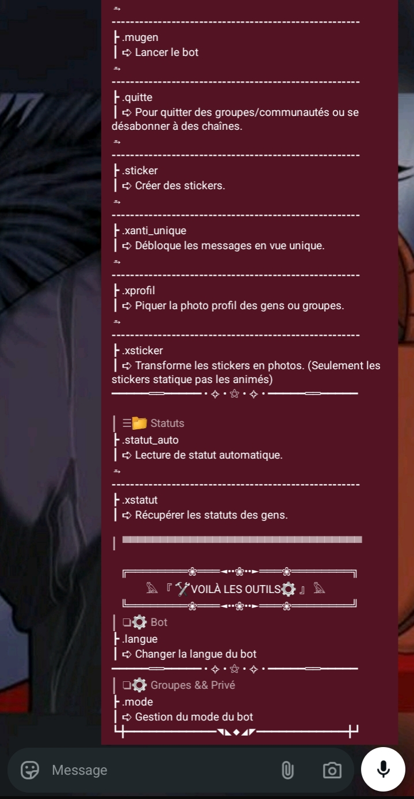

[Español](lis_moi_es.md) [Français ](../README.md)

# Mugen WA Bot ♾️♾️
| Mugen | Menu |
|-------|------|
|  |   |

[](https://nodejs.org/fr)
[](https://github.com/WhiskeySockets/Baileys)

[](https://github.com/moneythemoney999/mugen_wa_bot?tab=MIT-1-ov-file)

* Yon bot whatsapp pwisan ak modilè, fleksib ak miltilang.

## ~Tab matyè yo~

- [A propo](#a-propo)
- [Fonksyonalite](#Fonksyonalite)
- [Teknoloji itilize ](#Teknoloji-itilize)
- [Prereki](#prereki)
- [Instalasyon](#instalasyon)
- [Itilizasyon](#itilizasyon)
	- [Demaraj bot la](#demaraj-bot-la)
	- [Otantifikasyon](#otantifikasyon)
	- [Kòmand](#komand)
	- [Zouti](#zouti)
- [Stikti projè a](#stikti-projè-a)
- [Kontribye](#kontribye)
- [Lisans](#lisans)
- [otè](#otè)

## ~A propo~

Mugen WA Bot♾️♾️ se yon bot polivalen, fleksib ak ektensib, ki kreye pa yon devlopè indepandan, konstwi avèk Node epi bibliyotèk Baileys pou entèraji avec API Whatsapp Multi-Device la. Konsepsyon modilè li a pèmèt ou ajoute nouvo kòmand, zouti oubyen fonksyonalite de nenpòt tip. Li ka jere plizyè sesyon similtaneman.

## ~Fonksyonalite~

🧩 **Modilè ak Ektansib** : Mete  fasilman nouvo fonksyonalite, kòmand ak zouti pèsonalize.
💬 **Interaksyon Whatsapp** : Gère les messages, les groupes, les participants ak les identifiants LID,PN,JID.
♾️ **Jesyon Milti-Sesyon** : Exécute plusieurs instances du bot simultanément avec des sessions ak numéro distinctes.
🔌 **Otantifikasyon Fleksib** : Sipò otantifikasyon pa kòd QR oubyen kòd pè.
🌐 **Miltilang** : Pran an chaj plizyè ak diferan lang.

## ~Teknoloji itilize~

*	**Node.js** 24(Eksekitè JavaScript san navigatè)
*	**Whiskeysockets Baileys** 7.0.0-rc.14(API WhatsApp Multi-Device)
*	**qrcode-terminal** (Jenerasyon de kòd QR nan tèminal la)
*	**NPM** (Jesyonè pakèt JavaScript)
*	Ak lòt modile Node.js standa tankou `fs`, `path`, `readline`, `util`.

## ~Prereki~

Anvan ou kòmanse, asirew kew gen eleman sa yo instale:

*	**Node.js** (v20 men vèsyon 24 la trè rekòmande nan Termux)
*	**npm** oubyen **yarn** (Jesyonè pakèt)

## ~Instalasyon~

Swiv etap sa yo pou konfigire bot la :

1.	**Clone depo a :**
	```bash
	git clone https://github.com/moneythemoney999/mugen_wa_bot.git
	cd mugen_wa_bot
	```

2.	**Instalasyon depansans :**
	### **linux,windows,macOS ak anviwònman linux nan Termux(proot/chroot):**
	```bash
	npm install
	```
	obyen
	```bash
	yarn install
	```

	### **Termux san anviwònman linux proot oubyen chroot instale:**
	**Pou itilizatè Termux yo (senp san anviwònman linux installe ladanl) ou pa dwe lanse `npm/yarn install` paske yon nan pakè nesesè yo pa pre-compile pou Termux.*

	- Alò mw menm mw fèl pou nou menm poun itilizel nou dwe itilize spesifikman node 24
	- Pou benefisye ou dwe lanse kòmand sa :
		```bash
		chmod +x installation.sh && ./installation.sh #yon pèmèt ou bay fichye a dwa ekzekisyon yo epi lot la pèmèt ou ekzekitel
		```
	- Lap fè tout nesesè yo poul téléchaje epi installe depansans lan ak lòt yo.

3.	**Konfigirasyon sesyon yo (Opsyonèl, men nesesè pou lanse plizyè sesyon) :**
	- Kreye fichye `session.js` nan rasin projè a (nan menm nivo ak fichye `mugen_wa_bot.js` la) sil pa ekziste. Nan fichye sa, ou ka defini sesyon ou vle lanse yo. Chak apèl `demarer_bot("session")` ap lande yon nouvo sesyon. Epi li sipòte kòmantè miltilig oubyen non.
	- Egzanp de `session.js` :
		```javascript
		demarer_bot("mugen");

		// Lanse yon lòt sesyon ki rele "mugen1"
		/*
		demarer_bot("session1");
		*/

		// Kòmante/dekòmante lig yo selon sesyon ou vle lanse yo.
		// Sesyon ki pa kòmante yo ap demare nan lansman bot la.
		```
	- Si `session.js` pa egziste oubyen vid, yon sesyon ki rélé "mugen" ap lanse.

## ~Itilizasyon~

### Demaraj bot la
* Pou demare bot la, egzekite fichye prensipal la `mugen_wa_bot.js` :

```bash
node mugen_wa_bot.js
```

### Otantifikasyon

- Pandan premye demaraj bot la, bot la ap mandew chwazi yon metòd otantifikasyon :

1.  **Kòd QR** : Yon kòd QR ap afiche nan tèminal la. Eskanel avèk telefòn ou an : WhatsApp > Appareils connectés > Connecter un appareil. Epi ou eskanel.
2.  **Kòd peraj** : Ou dwe mete nimewo telefòn ou an san espas yo ni sig olis la(+) oubyen parantèz yo. Wap jwen yon kòd, kew dwe al mete nan : WhatsApp > Appareils connectés > Connecter un appareil > Connecté plutôt avec un numéro de téléphone. Epi ou tapel.

- Fichye auth yo pral sovgade nan dosye `.secret/.auth/<nom_de_session>` lan pou lòt demaraj yo.
- Donk pa manyenl siw pa gon bon rezon oubyen kew pa konn sa wap fè a.

### Kòmand

* Bot la ap tann evenman de Baileys, poul transmèt yo bay tout kòmand an zouti yo pou si youn nan yo bezwen eveneman sa. Epi lap filtre tout message qui kòmanse pa prefiks la poul rele kòmand oswa zouti sa a, sil pa jwenn li lap voye yon mesaj erè poul di sa.
* _Pou chajman otomatik ak rechèch kòmand ak zouti yo gen kèk kaz pouw respekte_
* **Men yon egzanp  :**
```javascript
export defaut {
	nom : "non kòmand lan",
	description : "deskripsyon kòmand lan,
	categorie : "kategori kòmand lan",
	infos : "Plis infomasyon sou kòmand lan ke blòk 'description' an", //li pa obligatwa
	execute : "vrè lojik kòmand la. kap ekzekite pande apèl kòmand lan {si gen agiman ou vle inpòte depi fichye prensipal la se la}"
}
```

### Zouti

- Bot ka itilize yon sistèm zouti modilè ki ka reyaji a diferan eveneman. Zouti sa yo chaje dinamikman depi dosye `outils` a.
- Eux qui peuvent travailler en arrière-plan sans avoir besoin de déclanchement oar le préfixe, ak qui peuvent affecter le comportement du reste du bot.
- Menmjan pou kòmand yo gen kèk kaz pou respekte.
- __Egzanp__ :
```javascript
export defaut {
	nom : "non zouti a",
	evenement : "evenman kr zouti sa vle tan nan", //li ka pran yon oubyen plizyè
	desciption : "deskripsyon zouti a",
	categorie : "...",
	infos : "...",
	affiche_menu : "{vrai/faux}", chan sa pèmèt ou pa afiche zouti sa nan meni bot la si sil la sèlman poul travay an aryè plan. Sil pa nan fichye a oubyen li defini sou `faux` meni an pap afichel.
	execute : "menmjan pou kòmand yo se la lojik pou egzekite a ap ye"
}
```

## Strikti projè a

```
.
├── commandes/					# Kòmand yo
├── outils/					# Zoutil yo
├── langues/{la_langue}/		# Dosye/fichye diferan lang yo
│						└── {la_langue}.json # Infomasyon sou lang lan (non, kòd)
│						└── commandes/
│						└── outils/
├── memoires/					# Dosye pou done pèsistan sou sesyon yo, kòmand yo, zouti yo)
│	├── memoires_commandes/	# Kòmand yo
│	├── memoires_sessions/		# Sesyon yo
│	└── memoires_outils/		# Zouti yo
├── stockage/					# ...
├── lis_moi/					# Dosye ki gen imaj ak fichye readme yo tradui nan diferan lang
├── .secret/					# Dosye ki gen infomasyon sansib yo
│	└── .auth/					# Done otantifikasyon sesyon WhatsApp yo
│	└── .cles_ia/				# Klé API IA
├── mugen_wa_bot.js			# Fichye prensipal bot la
├── installation.sh			# Egzekitab pou instalasyon depandans yo su Termux sinp
├── package.json				# Infomasyon sou projè a ak depandans yo
├── package-lock.json			# Vérouyaj vèsyon depandans yo
├── session.js					# Fichye pou konfigire ak lanse plizyè sesyon
└── README.md					# Fichye README prensipal la
```

## Kontribye

Janm te dil la se yon projè kote map travay sèl, men si gen moun ki vle kontribye mwen pa kont😅(→⁠_⁠→)(←⁠_⁠←).
An ale map tan nou.

# Lisans

Projè sa a sou lisans MIT, epi lib aksè alò mwen pa responsab move itilizasyon.
[Licence](LICENCE)

# Otè
[Money Mugen♾️♾️](https://github.com/moneythemoney999)
